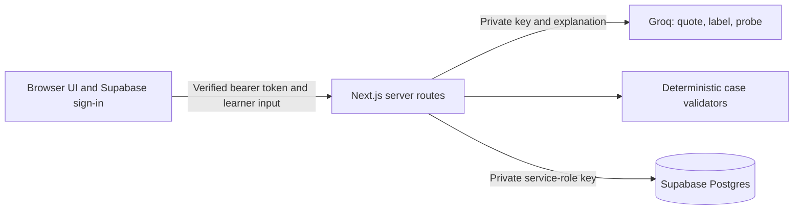

# ConceptChek

Live app: [conceptchek.vercel.app](https://conceptchek.vercel.app).

A full-stack learning app built with Next.js, React, Groq, and Supabase. Explain a concept, apply it to a case, respond to one reasoning probe, then apply it to a different case. Code grades the cases; AI never declares that a learner understands.

## Start locally

Requirements: Node.js 22 or later and npm.

```powershell
npm install
Copy-Item .env.example .env.local
npm run dev
```

Open http://127.0.0.1:3000. The default development mode is a **local demo**, with clearly labeled mock AI and a server-side JSON store at `.local/data.json`. No credentials are needed. Reloading the page preserves your sessions; another browser profile gets a separate learner. The illustrative mock replay does not save any results. Demo mode is disabled in production.

## Connect real Supabase and Groq

1. Create a Supabase project. In its SQL editor, run the entire current `supabase/setup.sql`. This combines the initial migration and seed data in one transaction and can be rerun after an interrupted initial setup without deleting learner data. Alternatively, run `supabase/migrations/001_initial.sql`, then `supabase/seed.sql`.
2. Enable Email/Password authentication. Set the Auth Site URL to your local URL during testing and add the eventual Vercel URL before deployment. If email confirmation is enabled, confirm the account before signing in.
3. Obtain the project URL, public anon key (or publishable key), and server service-role key from Supabase. Obtain a Groq API key from the Groq console.
4. Edit `.env.local`:

```dotenv
APP_MODE=live
NEXT_PUBLIC_SUPABASE_URL=https://your-project.supabase.co
NEXT_PUBLIC_SUPABASE_ANON_KEY=your-public-anon-or-publishable-key
SUPABASE_SERVICE_ROLE_KEY=your-server-service-role-key
GROQ_API_KEY=your-groq-key
GROQ_MODEL=openai/gpt-oss-120b
ADMIN_EMAILS=
```

5. Restart `npm run dev`, create an account, and sign in.

Only the URL and public key go to the browser. Groq and the Supabase service-role key stay in server routes. Do not prefix private keys with `NEXT_PUBLIC_`, commit `.env.local`, or paste credentials into chat. `GROQ_MODEL` is configurable: choose a model enabled for your Groq account that supports JSON-object output. API failures do not silently become mock responses in live mode.

Optional `ADMIN_EMAILS` is a comma-separated list of verified account emails permitted to see cross-learner sentence frequencies. Everyone else sees only their own learning record. Shared trends contain exact learner sentences, labels, and aggregate counts, with no account names or IDs. The app displays a learning-analysis notice before practice; every saved session and submission is included automatically, without a consent checkbox. Do not put personal information into an explanation.

## Deploy later to Vercel

The frontend and backend deploy as one Next.js project. There is no separate backend host to configure.

1. Commit the project and push it to the existing GitHub remote.
2. Import the repository in Vercel using the Next.js framework preset and Node.js 22 or 24. Leave the root directory as the repository root, use `npm run build`, and retain the default output directory.
3. Add the environment variables above to the appropriate Vercel environments, with `APP_MODE=live`. `NEXT_PUBLIC_*` variables must exist at build time; redeploy after changing them.
4. Deploy. Update Supabase Auth Site URL/redirect settings to your deployed domain.
5. Create an account and run a full explanation → case → probe → different case → summary session.

Do not use the local JSON store on Vercel: production always requires Supabase. The app is deployed to the Vercel project `conceptchek` in the `d100` scope at https://conceptchek.vercel.app. Production variables are configured in Vercel; private local files are excluded by `.vercelignore`. The SQL migrations were applied by the project owner in Supabase SQL Editor.

### Production email confirmation links

In Supabase **Authentication → URL Configuration**, set **Site URL** to `https://conceptchek.vercel.app` and add `https://conceptchek.vercel.app/**` to **Redirect URLs**. This is needed for new-user confirmation links to return to the hosted app. Keep a localhost redirect entry if local confirmation testing is still needed.

The GitHub repository is connected to Vercel with `main` as the production branch. Pushing commits to `main` triggers a production deployment; a successful deployment updates the live app.

To deploy manually from this linked local project:

```powershell
vercel deploy --prod --scope d100
```

## What is implemented

- Seven database-backed concepts matching the supplied concept golden-answer reference: backend purpose, API calls, secret keys, persistence and retrieval, relationship pointers, history rows, and component placement.
- Four deterministic cases per concept (28 total): the ten original golden cases, the earlier supplemental Q11, and 17 additional cases. See [the full question bank](docs/question-bank.md) for prompts, answer structures, golden answers, and concept reference reasoning.
- A visible learning-analysis notice, verbatim suspected recital quote, label under five words, and LLM comparison with this learner’s prior labels. Existing labels are reused only for model-reported confidence **strictly greater than 0.95**. Confidence is a model judgment, not a calibrated statistical measurement.
- One probe and response linked to the conversation, different case IDs, exact before/after grading, timestamps, resumable sessions, and optimistic concurrency checks.
- Format errors identify each invalid field or array entry, its submitted value, and the permitted values or required type. An expandable field guide is available before submission. Missing fields, unexpected keys, JSON syntax, nested structures, and array lengths receive specific feedback. Invalid labels from outside the question’s candidate set are format errors; valid but wrong assignments still receive INCORRECT. Format errors are recorded as attempts but do not advance the session or count as incorrect application. A structurally valid answer is graded once and advances the sequence.
- `demonstrated_change`: null until both cases are graded; +1 for incorrect → correct; 0 for matching outcomes; −1 for correct → incorrect. The database checks this invariant independently of application code.
- Cases prefer unseen questions. When the small bank is exhausted, the app labels repeat practice and excludes it from the fresh-case improvement metric. A correct second case does not establish that the AI probe caused learning.
- Personal history, phrase recurrence, repeated application-gap signals, administrator-only shared sentence frequencies, and an illustrative replay.

## Architecture and data mapping



The supplied spreadsheet’s `User_Table`, `Concept_Table`, `CaseQ_Table`, and `Conversation_Table` map to `profiles`, `concepts`, `case_questions`, and `conversations`. Database names use consistent snake_case and correct spelling. The additional `recitals` table stores each learner’s canonical phrase labels, and `case_attempts` records every case submission with a timestamp and status, including format errors. Notice-display and probe-answer timestamps are stored on the conversation. Historical explicit-consent timestamps are retained; new sessions leave consent_at null.

Both before/after cases, the recital, the probe, and its response belong to the same conversation ID; the second attempt therefore remains linked to the gap it tests. Concepts and cases are tables so content can be updated without redeploying the UI. Validators remain code; a newly added validator type needs an implementation and tests.

Browser database writes are blocked by RLS. API routes verify Supabase identity and filter conversations by that verified user ID before using the service-role client. Golden answers and validator configuration are never returned by API responses. Database access is isolated in a `server-only` module. Concurrent stale submissions are rejected with HTTP 409.

## Checks

```powershell
npm test
npm run typecheck
npm run build
# With npm run dev running in demo mode in another terminal:
node scripts/smoke-test.mjs
```

The smoke test creates isolated demo learners and exercises the full flow for all seven concepts, format correction, +1 change, automatic analysis, persistence, distinct cases, repeat-practice marking, cross-origin rejection, ownership isolation, and stale/completed submission rejection. Its records belong to a separate cookie and do not appear in your normal browser workspace. It deliberately refuses to run against live mode.

Regenerate both the SQL seed and combined setup after changing the built-in catalog or initial migration:

```powershell
npx tsx scripts/seed.ts
npx tsx scripts/export-question-bank.ts
```

For an existing hosted project, run `supabase/migrations/002_four_cases_per_concept.sql` in Supabase SQL Editor and refresh the app. This extends the validator constraint and upserts the content without deleting existing learner data. For a new project use the combined setup file.

The database regression tests execute the generated SQL in embedded PostgreSQL, compare every stored JSON golden answer with the catalog, and verify that rerunning setup preserves learner data. This also covers recovery when the schema succeeded but the seed failed.

### Supabase key replacement

In Supabase **Settings → API Keys → Publishable and secret API keys**, create or select a publishable key (`sb_publishable_...`) and secret key (`sb_secret_...`). Put the publishable key in `NEXT_PUBLIC_SUPABASE_ANON_KEY` and the secret key in `SUPABASE_SERVICE_ROLE_KEY`; these existing variable names support both key generations. Keep them only in `.env.local`.

Supabase's legacy `anon` and `service_role` keys are tied to the legacy JWT secret and are not independently rotatable. After verifying the new keys and migrating any other clients, deactivate legacy API keys in the dashboard. See the [official migration guide](https://supabase.com/docs/guides/getting-started/migrating-to-new-api-keys). Replacing the key in this app alone does not invalidate an exposed legacy key.

Live Groq analysis and Supabase connectivity were checked separately. The Vercel deployment was verified with public HTTP requests and a browser: the sign-in page loads, live mode is enabled, and anonymous dashboard/session API requests return 401. A complete hosted sign-up and signed-in learning session still needs a user walkthrough. Unit tests and local demo checks alone do not establish live service connectivity.

## Automatic learning analysis

Run `supabase/migrations/003_automatic_learning_analysis.sql` once on an existing project to allow new sessions without falsely recording checkbox consent. It preserves historical consent timestamps and adds a separate notice-display timestamp. New installs use the updated setup file.

Practice has no checkbox or consent flag. A notice states that explanations are sent to Groq and saved responses contribute to administrator learning trends. Administrator insights cover all saved sessions and case submissions, including unfinished sessions, incorrect answers, and format errors. Summary counts and per-concept outcomes are aggregated on the server; names and user IDs are not returned. Only authenticated emails in ADMIN_EMAILS receive these cross-learner aggregates; other users continue to see personal insights only. Sentence frequencies show the top 20 groups across all saved sessions.

## References

- [Hackathon brief](https://100x-curriculum.vercel.app/c8/module-2/hackathon/concept-check)
- Supplied implementation files: `03_UI_SystemDesign_Data.docx`, `02_GoldenInput_Output_Pairs.docx`, and `Table_excel.xlsx`. These were read as product specifications; they did not authorize external publishing or account changes.
- [Next.js installation](https://nextjs.org/docs/app/getting-started/installation), [Supabase authentication](https://supabase.com/docs/guides/auth/server-side/creating-a-client), [Groq API compatibility](https://console.groq.com/docs/openai), [Groq models](https://console.groq.com/docs/models).
